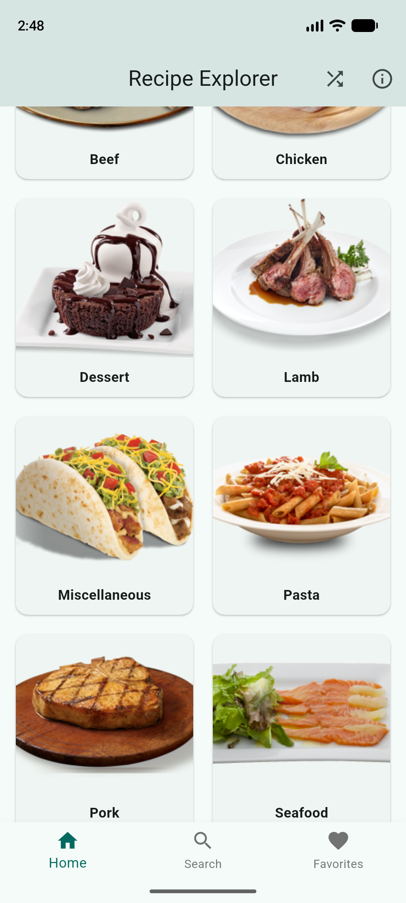
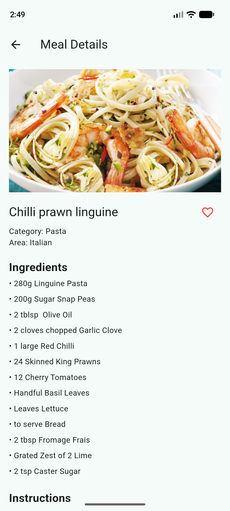
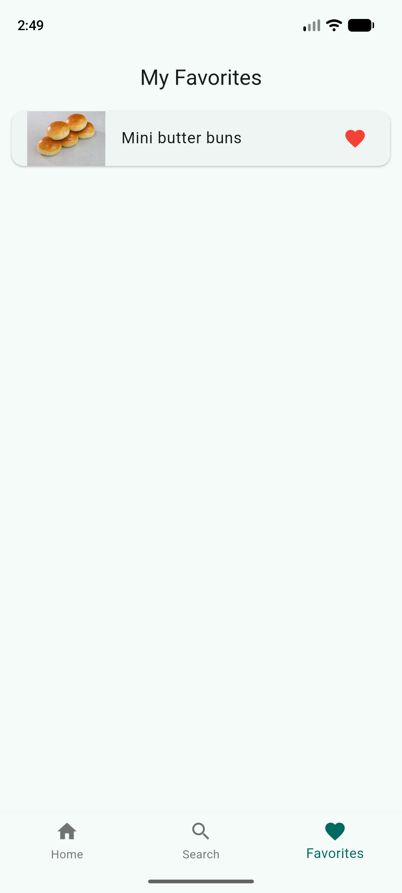

# Recipe Explorer

Recipe Explorer is a Flutter app where users can find and explore different food recipes. I made this app using TheMealDB API as my final project for Mobile App Design.

## Features

- View different recipe categories on the home screen
- See recipes from each category
- View recipe details, ingredients, measurements, and cooking instructions
- Search recipes by name
- Save recipes to favorites
- Remove recipes from favorites
- Favorites remain saved after closing the app
- Get a random recipe using the Random Meal feature
- Home, Search, and Favorites navigation
- Loading indicators and error messages with Retry options
- About screen with my information and photo

## Tools and Technologies

- Flutter 3.47.5 • channel stable
- Dart 3.13.4
- TheMealDB API
- HTTP package
- SharedPreferences

## How to Run

1. Clone or download this repository.
2. Open the project in VS Code.
3. Run the following command:

   `flutter pub get`

4. Start the app:

   `flutter run`

## About Me

Name: SHORMY SHOMILY DAS

Student ID: 2024991215

Course: Mobile App Design

Semester: 2026-2

## Bonus Feature

Random Meal – Shows a random recipe when the user presses the Random Meal button.

## Screenshots

### Home Screen

### Meal Details

### Favorites

